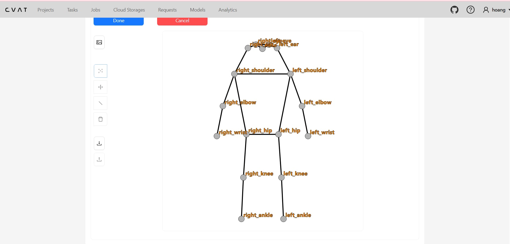
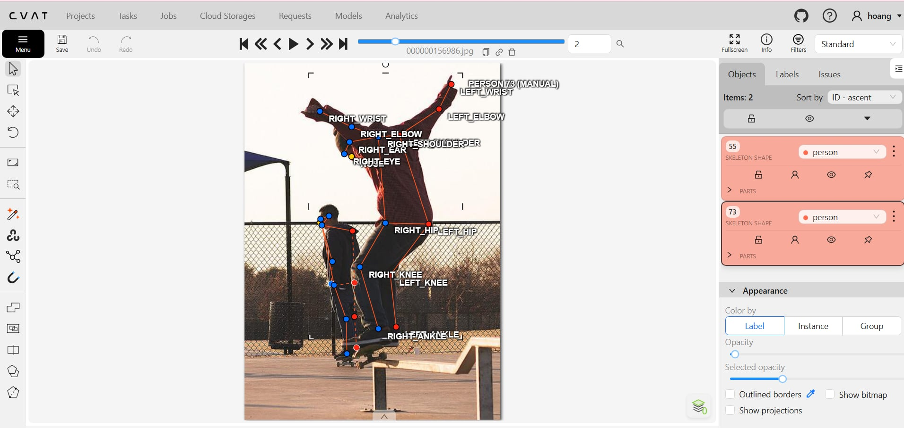
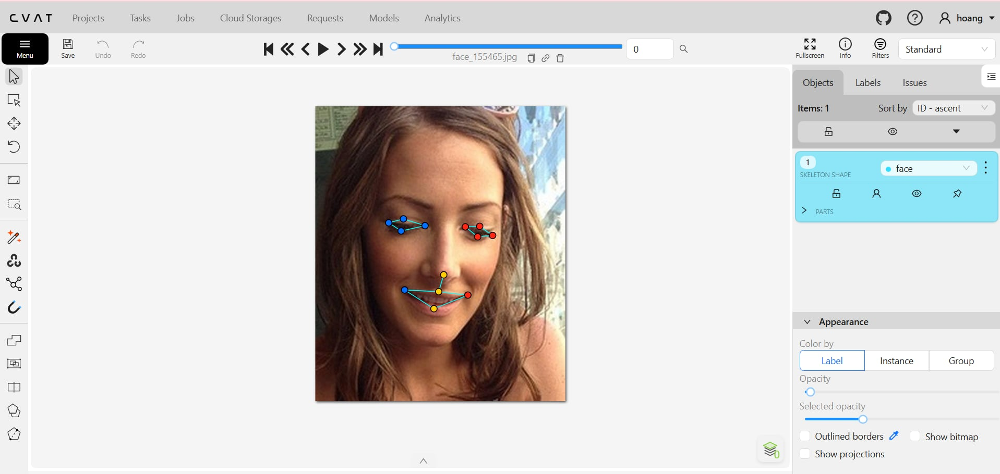
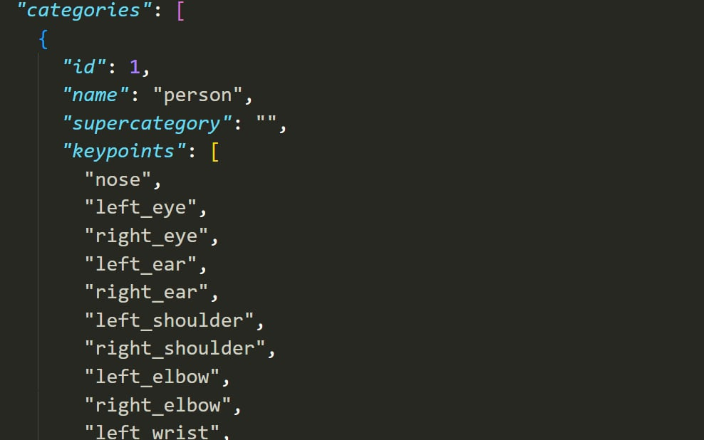

# Báo cáo cá nhân — HoVaTen-MSSV
Dữ liệu: 12 ảnh người COCO val2017 (Lin et al., 2014) và 8 ảnh chân dung Wikimedia Commons, chỉ dùng trong lớp.

## 0. Thông tin học viên

- Họ tên: Phạm Việt Hoàng
- MSSV:2A202603254
- Email:phamviethoang.dev@gmail.com
- Link repository: https://github.com/Pviethoang020704/K5-L2-Day03-Image-Segmentation.git
- Phiên bản CVAT (Help → About):2.82.1
- Máy: hệ điều hành win 11 · RAM 8 GB · chạy CVAT chế độ đầy đủ
- Bộ ảnh (`src/exports/assignment.json` do `lab.py setup` tạo): có
- Giờ bắt đầu:4 giờ
- Giờ kết thúc:8 giờ

## 1. Kiểm tra label (CP0)

| Label | Kiểu | Số điểm | Tên điểm đúng bảng của lab? | Đúng thứ tự? | Số cạnh |
|---|---|---:|---|---|---:|
| `person` |Skeleton | 17| có|có |19 |
| `face` | Skeleton| 13|có |có |13|

Mẫu `person` dựng theo người quay mặt về camera (các điểm `left_*` nằm bên phải khung mẫu)? Có 

Cách đổi cờ `occluded` / `outside` cho **một điểm** trên phiên bản CVAT này (một câu):
-  Q: occluded
-  O: outside

## 2. Số lượng đã gán và thời gian (CP1, CP2)

| Nhóm ảnh | Số ảnh | Số skeleton đã gán | Số người dưới 60 px (không gán) | Số poster / gương / màn hình bỏ qua | Thời gian (phút) |
|---|---:|---:|---:|---:|---:|
| `easy` | 5 |5 |0 |0 |30 |
| `occluded` | 3 |5 |0 |0 |30 |
| `back` | 2 |4 |0 |0 |25 |
| `small` | 1 |2 |0 |0 |20 |
| `crowd` | 1 |3 |0 |0 |20 |
| `faces` | 8 |8 |0 |0 |10 |

- Số ảnh người đã xong ở mốc phút 105: 5 / 10
- Thời gian thực tế (phút): CP1 60 · CP2 60 · CP3 60
- Ảnh tốn thời gian nhất là ảnh nào, vì sao?

Ảnh 000000043500.jpg vì người ở tư thế khó xác định hướng cơ thể, một số điểm khớp không nhìn rõ. 
## 3. Bảng ca khó (CP1, CP2)

Mỗi điểm bạn phân vân một dòng, nhất là phân vân giữa `v = 1` và `v = 0`, hoặc không chắc hướng người.

| Ảnh | Người / mặt | Điểm | Cờ đã chọn | Phân vân giữa | Lý do chọn |
|---|---|---|---:|---|---|
| `000000043500.jpg` | Person #1 | `nose` | `v=0` | `v=0` / `v=1` | Đầu người ở góc khó quan sát, không xác định được chính xác vị trí mũi nên chọn v=0. |
| `000000043500.jpg` | Person #2 | `right_wrist` | `v=0` | `v=0` / `v=1` | Cổ tay bị che khuất, không đủ căn cứ xác định vị trí nên chọn v=0. |
| `000000156986.jpg` | Person #1 | `left_shoulder` | `v=1` | `v=1` / `v=0` | Vai trái bị che nhưng vẫn có thể ước lượng vị trí dựa vào phần thân người còn nhìn thấy nên chọn v=1. |
| `000000167027.jpg` | Person #2 | Nhiều keypoint | `v=0` | `v=0` / `v=1` | Người có kích thước nhỏ, nhiều khớp không quan sát được rõ nên đánh dấu outside cho 11/17 điểm. |
| `000000183176.jpg` | Person #2 | Các cặp trái/phải | `v=2` | Trái / phải | Tư thế người gây khó khăn khi xác định hướng cơ thể, cần đối chiếu vai, hông và chân để tránh đảo keypoint trái/phải. |

## 4. Bảng tự review (CP3)

Đi từ ảnh cuối về ảnh đầu. 5 ảnh người (ít nhất 2 ảnh `back` hoặc `crowd`) và 3 ảnh mặt. Ít nhất 8 dòng, kể cả dòng `ok`. Ghi lỗi trước, sửa sau.

Mã lỗi dùng đúng một trong: `lr_swap`, `vis_flag`, `position`, `missing`, `extra`, `ok`.

| Ảnh | Người / mặt | Điểm | Mã lỗi | Ghi chú | Đã sửa? |
|---|---|---|---|---|---|
| `000000351176.jpg` | Person #2 | LEFT/RIGHT | `lr_swap` | Script cảnh báo đảo trái/phải, kiểm tra tư thế quay lưng. | rồi |
| `000000309169.jpg` | Person #1 | LEFT/RIGHT | `lr_swap` | Kiểm tra hướng thân người và vị trí các khớp trong ảnh đông người. | rồi |
| `000000043500.jpg` | Person #1 | Mũi, mắt, tay | `vis_flag` | Có 5 điểm v=0, kiểm tra khả năng định vị các điểm bị che. | rồi |
| `000000167027.jpg` | Person #2 | Toàn bộ người | `extra` | Chiều cao trải keypoint 56 px, cần kiểm tra chiều cao người thực tế. | rồi |
| `000000183176.jpg` | Person #2 | LEFT/RIGHT | `lr_swap` | Script cảnh báo hướng trái/phải, kiểm tra vai, hông và chân. | rồi |


Tổng hợp số lỗi theo mã:

| `lr_swap` | `vis_flag` | `position` | `missing` | `extra` | `ok` |
|---:|---:|---:|---:|---:|---:|
|3 |1 |0 |0 |1 |3 |

Điểm còn phân vân giữa `v = 1` và `v = 0` (ghi cả hai lựa chọn và lý do chọn):
Hai lựa chọn:
- `v=1`: Cổ tay bị che khuất nhưng vẫn có thể xác định vị trí dựa trên hướng cẳng tay.
- `v=0`: Không thể xác định vị trí cổ tay một cách đáng tin cậy.

Trong file COCO đã xuất, tôi chọn `v=0`. Điểm cổ tay khó quan sát và chưa có đủ căn cứ để ước lượng vị trí chính xác.
## 5. Kiểm file xuất và kết quả tự kiểm (CP4)

Tự kiểm tay trong file JSON:

| File | Người / mặt kiểm (ảnh, thứ tự) | Số phần tử `keypoints` | Điểm `outside` ra `v = 0`, `occluded` ra `v = 1`? | `num_keypoints` khớp? |
|---|---|---:|---|---|
| `HoVaTen_persons.zip` |000000043500.jpg, Person #1 |51 |5 điểm v=0 |12 — Khớp |
| `HoVaTen_persons.zip` |000000156986.jpg, Person #1 |51 |4 điểm v=0, 3 điểm v=1 |13 — Khớp |
| `HoVaTen_faces.zip` |face_155465.jpg, Face #1	 |39 |13 điểm v=2 |	13 — Khớp |

Sau khi xuất, CVAT ghi `occluded` thành `v = 1` và `outside` thành `v = 0`. Tọa độ của điểm `outside` là tọa độ cũ? 

Hai job đã chuyển sang completed trên CVAT? Có 

Dán phần **TÓM TẮT** in ra từ `src/check_submission.py`:
- File person: PhamVietHoang_persons.zip
  Số ảnh: 12 · số skeleton person: 19 · mỗi annotation 51 số
  Skeleton theo ảnh: 000000043500=2, 000000137767=1, 000000156986=2, 000000167027=2, 000000175703=1, 000000183176=2, 000000309169=3, 000000351176=2, 000000433787=1, 000000463932=1, 000000516902=1, 000000558066=1
  Cờ v: v=2 245 (76%) · v=1 17 (5%) · v=0 61 (19%)
  num_keypoints trung bình: 13.8

- File face: PhamVietHoang_faces.zip
  Số ảnh: 8 · số skeleton face: 8 · mỗi annotation 39 số
  Skeleton theo ảnh: face_155465=1, face_256814=1, face_288853=1, face_380639=1, face_436791=1, face_442231=1, face_469647=1, face_490361=1
  Cờ v: v=2 104 (100%) · v=1 0 (0%) · v=0 0 (0%)
  num_keypoints trung bình: 13.0

- Số [LỖI]: 0 · số [CẢNH BÁO]: 7
Kết quả: ĐẠT

Các `[CẢNH BÁO]` còn giữ nguyên và lý do:

- `000000167027.jpg` #2: Cảnh báo chiều cao trải keypoint 56 px. Kiểm tra kích thước toàn bộ đối tượng để xác định có thuộc diện bỏ qua hay không.
- `000000183176.jpg` #2: Cảnh báo LEFT/RIGHT, kiểm tra theo hướng cơ thể.
- `000000309169.jpg` #1: Cảnh báo LEFT/RIGHT trong ảnh nhiều người.
- `000000351176.jpg` #2: Cảnh báo LEFT/RIGHT với người quay lưng.
- `000000433787.jpg` #1: Cảnh báo LEFT/RIGHT, đối chiếu các cặp vai, hông và chân.
- `000000516902.jpg` #1: Cảnh báo LEFT/RIGHT, đối chiếu hướng người.
- `000000558066.jpg` #1: Cảnh báo LEFT/RIGHT, đối chiếu hướng người.

Các cảnh báo LEFT/RIGHT xuất phát từ kiểm tra tọa độ tự động và không nhất thiết là lỗi gán nhãn. Việc giữ hay sửa nhãn dựa trên kết quả đối chiếu ảnh thực tế trong CVAT.

## 6. Ảnh chụp màn hình

1. Label `person` trong label constructor (đủ 17 điểm có tên):

   

2. Một người quay lưng đã gán, cờ đã đặt:

   

3. Một khuôn mặt đã gán 13 điểm, phóng to vùng mắt:

   

4. Một đoạn JSON xuất của một người:

   

Nguồn ảnh: COCO val2017 / Wikimedia Commons.


## 7. Tự đánh giá

1. **Lỗi dễ mắc và cách khắc phục:** Nhầm keypoint trái/phải khi người quay lưng. Cách khắc phục là kiểm tra hướng cơ thể trước khi gán nhãn.

2. **Quy tắc đề xuất:** Bổ sung hình minh họa người quay lưng, nghiêng và bị che khuất để phân biệt chính xác `v=0`, `v=1`, `v=2`.

3. **Tác động lên model:** Nếu gán nhầm `left_knee` và `right_knee`, model sẽ học sai vị trí khớp, tạo heatmap không chính xác và ảnh hưởng đến quá trình tính loss.

## 8. Khó khăn và lỗi kỹ thuật
Khó khăn chủ yếu là xác định keypoint bị che khuất và phân biệt trái/phải khi người quay lưng. Tôi đã kiểm tra lại các điểm khó và chỉnh sửa thủ công trên CVAT.
Quá trình xuất COCO Keypoints thành công. Script kiểm tra trả về ĐẠT, 0 lỗi và 7 cảnh báo.

## Bonus (nếu làm)

### B1 — 3 ảnh người khó thêm

| Ảnh | Số skeleton | Số người dưới 60 px | Ca khó nhất |
|---|---:|---:|---|
| | | | |
| | | | |
| | | | |

Kết quả `src/check_submission.py` cho `HoVaTen_bonus_persons.zip`:

```text
(dán ở đây)
```

### B2 — 5 ảnh khuôn mặt đen trắng / hồng ngoại

Ảnh không màu khó hơn ở điểm nào? Kính râm trên ảnh hồng ngoại có còn là `v = 1` không?

...

### B3 — Model so với nhãn của tôi (không tính điểm)

- Demo đã dùng:
- Ảnh đã thử:

1. Model có trả điểm cho khớp bị che, hay khớp ngoài ảnh không? Confidence ở các điểm đó thế nào?

   ...

2. Với người quay lưng, model có đổi trái/phải không?

   ...

3. Bộ điểm của model có giống 17 điểm COCO không?

   ...

## 9. Tài liệu tham khảo và công cụ AI đã dùng

1. VinUni AI thực chiến — Day 4 Keypoint Pose: https://github.com/VinUni-AI20k/K5-L2-KeypointPose-Student
2. ChatGPT — Hỗ trợ giải thích kiến thức, kiểm tra dữ liệu và hoàn thiện báo cáo.
